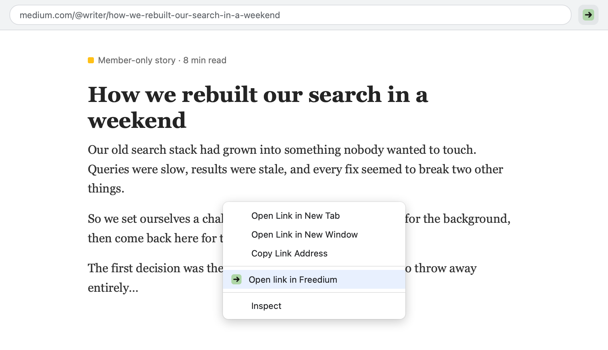

# Open in Freedium

A small browser extension (Chromium, Firefox and Firefox for Android forks like Iceraven) that opens the page you're on through
`https://freedium-mirror.cfd/<url>`, and falls back to other bypass sites when Freedium can't load it.

<p align="center"></p>

## Install

### Chrome, Edge, Brave and other Chromium browsers

1. Download **[freedium-extension.zip](https://github.com/capheproject/freedium-extension/releases/latest/download/freedium-extension.zip)** from the [latest release](https://github.com/capheproject/freedium-extension/releases/latest) and unzip it somewhere it can stay (the browser loads it from that folder).
2. Go to `chrome://extensions` (or `edge://extensions`, `brave://extensions`, …).
3. Turn on **Developer mode**.
4. Click **Load unpacked** and pick the unzipped folder.
5. Optional: pin the extension to the toolbar.

It isn't on the Chrome Web Store, so the browser may remind you on startup that a developer-mode extension is installed. That's expected.

### Firefox

1. Download **[freedium-extension-firefox.xpi](https://github.com/capheproject/freedium-extension/releases/latest/download/freedium-extension-firefox.xpi)** from the [latest release](https://github.com/capheproject/freedium-extension/releases/latest).
2. Go to `about:debugging#/runtime/this-firefox`.
3. Click **Load Temporary Add-on…** and pick the `.xpi`.

Firefox removes temporary add-ons when it restarts. To keep it installed, the `.xpi` has to be
signed by Mozilla: upload it to [addons.mozilla.org](https://addons.mozilla.org/developers/)
as an *unlisted* (self-distributed) add-on, and install the signed `.xpi` it gives back.
Firefox Developer Edition, Nightly and ESR can instead set `xpinstall.signatures.required`
to `false` in `about:config` and install the unsigned `.xpi` from `about:addons` → gear → **Install Add-on From File…**.

### Iceraven / Firefox for Android

Mobile Firefox has no `about:debugging`, so the add-on is installed from the file directly.

1. Download **[freedium-extension-firefox.xpi](https://github.com/capheproject/freedium-extension/releases/latest/download/freedium-extension-firefox.xpi)** to the phone.
2. Allow unsigned add-ons: open `about:config`, search for `xpinstall.signatures.required` and set it to `false`.
   (Iceraven and Firefox Nightly allow this; regular Firefox for Android doesn't, so it needs a version signed through addons.mozilla.org.)
3. Turn on the debug menu: **Settings → About Iceraven**, tap the logo five times.
4. Go back to **Settings**; tap **Install add-on from file** (near the bottom) and pick the `.xpi`.

On Android the extension shows up in the browser's main menu (⋮ → Extensions → Open in Freedium) and
opens the current page in a new tab. Android has no right-click menus or keyboard shortcuts, so only that entry is available.

## Use

- **Toolbar button** or **Alt+Shift+F**: opens the current page in Freedium in a new tab.
- **Press it again on that tab** to switch the same article to the next bypass site
  (Freedium mirror → Freedium → Scribe → archive.today → Wayback Machine, then back to the start).
- **Right-click a page or link** (desktop only): pick which site to open it with, or
  "Try next bypass site" while you're on one.
- On **Android** the button is in the browser menu (⋮ → Extensions → Open in Freedium).

### Automatic fallback

If a bypass site can't be reached or answers with an error page (HTTP 4xx/5xx), the tab moves on
to the next site by itself, until one loads or the list runs out. It only watches the first load,
so links you follow afterwards are left alone. Freedium sometimes shows an error message on a page that
otherwise loads fine; the extension can't tell that apart, so press the button again to move on.

### Settings

Open the extension's options (`chrome://extensions` → Details → Extension options; Firefox: `about:addons`
→ Open in Freedium → Preferences) to reorder, turn off, edit or add sites and to switch off the automatic
fallback. A site's address uses `{url}` for the article address, `{encoded}` for it percent-encoded, or
`{path}` for only its path (for Medium front-ends such as Scribe). When you add a site, the browser asks
for permission to see its pages, which the automatic fallback needs to notice HTTP errors.

To change the shortcut, go to `chrome://extensions/shortcuts` (Firefox: `about:addons` → gear → **Manage Extension Shortcuts**).

## Build

Both browsers share the scripts, options page and `icons/`; only the manifest differs
(`manifest.json` for Chromium, `firefox/manifest.json` for Firefox, which uses
background scripts instead of a service worker and carries the add-on ID). To make the release zips:

```
python3 build.py
```

This writes `dist/freedium-extension.zip` and `dist/freedium-extension-firefox.xpi`.
When bumping the version, change it in both manifests.

## Icon

The icons in `icons/` are drawn by `make_icons.py` (plain Python, no dependencies).
To tweak the colours or arrow thickness, edit `GREEN`, `INK` or `STROKE` in it, then run:

```
python3 make_icons.py icons
```

## License

MIT
